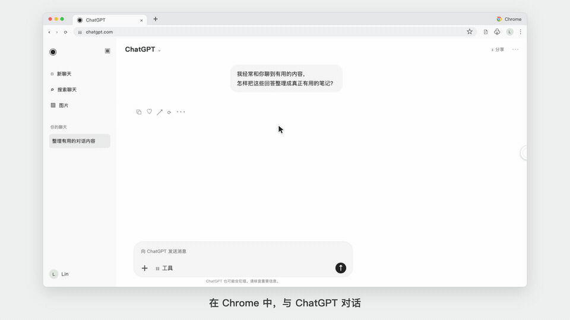

<div align="center">
  
  <h1>页笺 Yejian</h1>
  <p>在浏览器里，随时打开一页 Markdown 笔记。</p>
  <p>
    <a href="https://github.com/CCCCOOH/yejian-markdown-notes/archive/refs/heads/main.zip">下载插件</a>
    · <a href="#安装">安装方法</a>
    · <a href="docs/media/yejian-demo.mp4">观看完整视频</a>
  </p>
</div>

[](docs/media/yejian-demo.mp4)

## 聊到有用的内容，就在当前网页记下来

和 ChatGPT 聊到一个值得保留的方法，复制回答，点击网页边缘的白色圆环，就能打开页笺。粘贴要点，再补上一句自己的理解，笔记会自动保存。

记完后点击关闭，笔记窗收回圆环，继续刚才的对话。阅读文章、查阅资料时，也可以用同样的方式记录。

> 视频中的 Chrome／ChatGPT 界面为演示场景复现，页笺的打开、粘贴、编辑、保存和收起为实际操作录屏。

## 功能

| 功能 | 使用体验 |
| --- | --- |
| **所见即所得 Markdown** | 在同一个编辑区输入和查看格式。支持标题、加粗、列表、引用、代码块、任务列表与表格。 |
| **明暗主题** | 浅色、深色与跟随系统三种模式，偏好自动保存，并在多个窗口间同步。 |
| **网页悬浮笔记** | 拖动顶部移动窗口，拖动右下角调整大小，位置和尺寸会保存。 |
| **白色悬浮圆环** | 关闭窗口后收成圆环，点击展开。圆环可拖动，靠近边缘松手后会吸附并隐藏一半。 |
| **粘贴图片** | 直接粘贴截图或图片，自动保存到指定下载子目录，并在笔记中保留本地副本。 |
| **笔记管理** | 新建、重命名、切换、删除笔记，按标题和正文搜索。多个网页共享同一份笔记列表。 |
| **复制 Markdown** | 一键复制标题和正文，保留 Markdown 格式及已保存图片的本地路径。 |
| **自动保存** | 内容保存在当前浏览器中。多窗口编辑同一笔记发生冲突时，会保留冲突副本。 |

界面采用参考 Typora 的白底、浅灰侧栏与简洁排版，让主要空间留给正文。

## 安装

适用于支持 Manifest V3 的 Chrome 和 Edge。仓库中已包含可直接加载的插件文件。

1. [下载 ZIP](https://github.com/CCCCOOH/yejian-markdown-notes/archive/refs/heads/main.zip)，解压到一个固定文件夹。
2. 打开扩展管理页。Chrome 输入 `chrome://extensions`，Edge 输入 `edge://extensions`。
3. 开启右上角的 **开发者模式**。
4. 点击 **加载已解压的扩展程序**，选择解压后包含 `manifest.json` 的文件夹。
5. 在浏览器工具栏固定 **页笺**，打开普通网页后点击图标，即可开始记录。

插件加载后，请保留所在文件夹。更新时用新版文件覆盖原文件夹，再在扩展管理页点击 **重新加载**，并刷新已打开的网页，即可沿用已有笔记。

## 日常使用

### 打开与收起

首次在网页中使用时，点击浏览器工具栏的页笺图标。之后可以点击白色圆环展开窗口，用关闭按钮或 `Esc` 收起。

| 操作 | 方式 |
| --- | --- |
| 打开或收起 | 浏览器工具栏图标 |
| Windows / Linux 默认快捷键 | `Alt + Shift + N` |
| macOS 默认快捷键 | `Command + Shift + Y` |
| 移动窗口 | 拖动窗口顶部 |
| 调整大小 | 拖动右下角 |
| 隐藏或显示笔记列表 | 点击顶部侧栏按钮 |

快捷键可以在浏览器的扩展快捷键设置中修改。

### 明暗主题

在工具栏的 **更多格式 → 主题** 中选择 **跟随系统**、**浅色** 或 **深色**。默认跟随系统，系统外观变化时会自动切换。手动选择的主题会保存，并同步到其他已打开的笔记窗口。

### Markdown 编辑

输入下面的标记即可直接应用格式，也可以使用工具栏。

| 输入 | 格式 |
| --- | --- |
| `#` 后加空格 | 一级标题，支持一至六级 |
| `**文字**` | 加粗 |
| `*文字*` | 斜体 |
| `~~文字~~` | 删除线 |
| `-` 后加空格 | 无序列表 |
| `1.` 后加空格 | 有序列表 |
| `>` 后加空格 | 引用 |
| 三个反引号后加空格 | 代码块 |

工具栏支持插入任务列表、链接和表格。表格内可通过更多格式菜单增删行列。粘贴纯文本 Markdown 时会解析常用格式。按住 `Ctrl` 或 `Command` 单击正文链接即可打开。

### 图片保存

在正文按 `Ctrl + V` 或 `Command + V` 粘贴图片，支持 PNG、JPEG、WebP 和 GIF，每张最大 **12 MB**。

默认保存位置为浏览器下载目录中的 `页笺/images`。通过 **更多格式 → 图片保存位置** 修改下载目录内的子目录，新设置用于之后粘贴的图片。

复制 Markdown 时，图片会使用已保存文件的本地路径。跨设备分享笔记时，需要同时提供图片并调整路径。文件保存失败可点击图片下方的重试按钮，删除笔记会保留已保存的图片文件。

## 数据与兼容性

- 笔记及图片副本存储在当前浏览器配置文件中，本地编辑可离线使用。跨设备使用需要自行转移内容。
- 状态栏显示 **已保存** 时，笔记已经写入本机浏览器存储。卸载扩展会清除其存储，重要内容请提前复制保存。
- 普通网页使用悬浮窗。浏览器设置页、扩展商店等受限页面会打开独立笔记窗口。本地文件页面需开启扩展的 **允许访问文件网址**。
- 当前版本覆盖常用 Markdown 编辑。数学公式及部分 Typora 扩展语法尚未实现。

<details>
<summary>查看权限用途</summary>

| 权限 | 用途 |
| --- | --- |
| `activeTab`、`scripting` | 点击工具栏图标后，在当前网页打开悬浮窗 |
| `storage` | 保存笔记、图片目录设置及窗口位置 |
| `clipboardWrite` | 复制笔记 |
| `downloads` | 将粘贴的图片保存为本地文件 |
| `unlimitedStorage` | 保存笔记中的图片副本 |

</details>

## 开发

应用代码可直接编辑，重新加载扩展后生效。编辑器依赖已打包到 `vendor/editor.js`。

```text
background.js       窗口打开、笔记保存与冲突处理
overlay.js          网页悬浮窗与圆环交互
panel.html          编辑界面
panel.css           界面样式
panel.js            编辑及笔记管理
notes.js            笔记数据辅助逻辑
images.js           图片粘贴与显示
image-storage.js    图片文件保存
vendor/editor.js    本地打包的编辑器依赖
build/              依赖清单、锁文件及打包入口
```

如需重新打包编辑器依赖，在仓库根目录执行以下命令。

```sh
cd build
npm ci
npx esbuild vendor-entry.js --bundle --minify --format=esm --target=chrome130 --legal-comments=none --outfile=../vendor/editor.js
```

已在 Chromium 中验证编辑、复制粘贴、图片保存、搜索、删除、拖动、缩放、圆环吸附、刷新恢复及受限页面的独立窗口。

编辑器基于 Tiptap 3.33.0，第三方依赖许可见 [THIRD-PARTY-LICENSES.txt](THIRD-PARTY-LICENSES.txt)。
